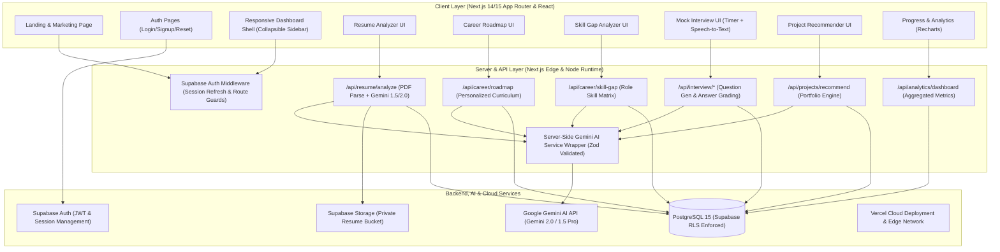

# AI CareerPilot — System Architecture & Development Plan

**Project:** AI CareerPilot  
**Tagline:** *Navigate Your Career. Powered by AI.*  
**Status:** Architectural Blueprint & Planning Stage (Prompt 1)  
**Author:** Senior Software Architect & Full-Stack Engineering Team  

---

## 1. Executive Summary & Architectural Principles

**AI CareerPilot** is an end-to-end AI-powered career navigation and job readiness platform tailored for college students, freshers, and early-career job seekers. The platform bridges the gap between educational background and industry hiring bars by providing real-time resume audits, personalized learning roadmaps, skills gap evaluations, simulated mock interviews, and project portfolio guidance.

### Core Architectural Principles:
1. **Server-First Security & Zero Secret Leaks:** Supabase service role keys, Gemini API keys, and sensitive prompts never touch client bundles. All AI calls and privileged mutations run in Next.js Server Components or secure Route Handlers.
2. **Strict Multi-Tenant Isolation:** Database design enforces PostgreSQL Row Level Security (RLS) on 100% of user data tables, bounded strictly by `auth.uid() = user_id`.
3. **Structured AI Contract Validation:** All responses from Google Gemini use JSON schema constraints and are validated through **Zod schemas** before persisting to database or returning to the UI.
4. **Resilience & Graceful Degradation:** Informative error states, realistic fallback messaging (never pretending an analysis succeeded when an API fails), optimistic UI updates, and clear disclaimers (e.g., ATS scores are algorithmic estimates, not employer ATS decisions).
5. **Production-Ready SaaS Aesthetics:** Modern dark navy and violet/purple palette (`#0B0F19`, `#1E1B4B`, `#7C3AED`, `#06B6D4`), crisp typography, smooth micro-interactions, responsive grid layouts, and clean Recharts data visualizers.

---

## 2. High-Level System Architecture



---

## 3. Technology Stack & Library Selection

| Layer | Technology | Version / Choice | Purpose & Justification |
| :--- | :--- | :--- | :--- |
| **Framework** | Next.js (App Router) | `14.x / 15.x` | Hybrid SSR/SSG, Server Actions, API Route Handlers, high SEO performance |
| **Language** | TypeScript | `^5.x` | Strict type-safety across database models, API payloads, and AI responses |
| **Styling** | Tailwind CSS | `^3.4` | Utility-first styling with custom dark navy/purple SaaS design system tokens |
| **UI Components** | shadcn/ui + Radix UI | Latest | Accessible, headless, customizable UI primitives (dialogs, tabs, progress, dropdowns) |
| **Icons** | Lucide React | Latest | Clean, consistent iconography throughout dashboard and marketing |
| **State Management** | React Server Components + Zustand / Context | React 18/19 | Lightweight local and global state (active interview session, filter controls) |
| **Database & Auth** | Supabase (`@supabase/ssr`) | Latest | Managed PostgreSQL with native Row Level Security, Auth, and Storage |
| **AI Engine** | Google Gemini API (`@google/genai`) | Gemini 1.5/2.0 Flash & Pro | Structured JSON output, multi-turn reasoning, prompt schema enforcement |
| **Data Analytics** | Recharts | `^2.12` | Composable, responsive SVG charts (radar charts for skills, area charts for progress) |
| **PDF Processing** | `pdf-parse` / `unpdf` | Latest | Robust server-side raw text extraction from uploaded resume PDFs |
| **Validation** | Zod | `^3.23` | Schema validation for user form inputs and Gemini structured JSON outputs |
| **Notifications** | Sonner | Latest | Smooth, accessible toast notifications for async API actions |
| **Deployment** | Vercel | Production | Native Next.js edge caching, CI/CD, SSL, and serverless compute |

---

## 4. Modular Directory & Folder Structure

```
aipilot/
├── .env.example                     # Sample environment variable template
├── .env.local                        # Local secrets (SUPABASE, GEMINI API KEY)
├── next.config.mjs                   # Next.js configuration & image domains
├── tailwind.config.ts                # Custom colors (navy, purple, accent gradients)
├── tsconfig.json                     # Strict TypeScript config with @/ path aliases
├── package.json                      # Dependencies and run scripts
├── supabase/
│   ├── migrations/
│   │   ├── 20240101000000_init_schema.sql      # Core table definitions
│   │   └── 20240101000001_rls_policies.sql     # RLS policies & triggers
│   └── seed.sql                      # Seed data for target roles & skill taxonomies
├── public/
│   ├── favicon.ico
│   ├── logo.svg                      # Custom vector logo
│   └── images/                       # Marketing illustrations and mock previews
├── src/
│   ├── middleware.ts                 # Route guards, Supabase session refresh
│   ├── app/
│   │   ├── layout.tsx                # Root layout (Theme provider, fonts, toasts)
│   │   ├── page.tsx                  # High-converting SaaS Landing Page
│   │   ├── not-found.tsx             # Branded 404 handler
│   │   ├── error.tsx                 # Global error boundary
│   │   ├── (auth)/
│   │   │   ├── login/page.tsx        # Login with email/password
│   │   │   ├── signup/page.tsx       # Signup & onboarding hook
│   │   │   ├── reset-password/page.tsx # Password recovery flow
│   │   │   └── callback/route.ts     # Supabase auth exchange route
│   │   ├── (dashboard)/
│   │   │   ├── layout.tsx            # Protected dashboard layout with collapsible sidebar
│   │   │   ├── dashboard/page.tsx    # Command center & career readiness score
│   │   │   ├── onboarding/page.tsx   # Initial target role & baseline skills intake
│   │   │   ├── resume-analyzer/page.tsx # PDF upload, ATS score, structured audit
│   │   │   ├── career-roadmap/page.tsx  # Timeline stages, milestones, weekly targets
│   │   │   ├── skill-gap/page.tsx       # Visual role requirement vs user skill radar
│   │   │   ├── mock-interview/page.tsx  # Interactive AI interview simulator
│   │   │   ├── mock-interview/[id]/page.tsx # Active interview session (timer + speech)
│   │   │   ├── project-recommender/page.tsx # Practical portfolio ideas & bookmarks
│   │   │   ├── progress/page.tsx        # Detailed historical progress & metrics
│   │   │   └── settings/page.tsx        # Profile info, target career, API preferences
│   │   └── api/
│   │       ├── resume/
│   │       │   └── analyze/route.ts     # PDF text extraction + Gemini resume prompt
│   │       ├── career/
│   │       │   ├── roadmap/route.ts     # Gemini personalized curriculum generation
│   │       │   └── skill-gap/route.ts   # Skills benchmark & gap computation
│   │       ├── interview/
│   │       │   ├── generate/route.ts    # Question generator by role/level/type
│   │       │   └── evaluate/route.ts    # Answer grading with STAR feedback
│   │       ├── projects/
│   │       │   └── recommend/route.ts   # Dynamic project portfolio recommendations
│   │       └── analytics/
│   │           └── dashboard/route.ts   # Live aggregated metrics from database
│   ├── components/
│   │   ├── ui/                       # shadcn/ui primitives (Button, Card, Dialog, etc.)
│   │   ├── landing/                  # Landing page sections (Hero, Features, Stats, Pricing, Testimonials)
│   │   ├── dashboard/                # Sidebar, TopNav, ReadinessCard, NextBestStep, ActivityFeed
│   │   ├── resume/                   # UploadDropzone, ScoreGauge, StrengthCard, ATSBreakdown
│   │   ├── roadmap/                  # TimelineTree, MilestoneItem, ResourceCard, ProgressDonut
│   │   ├── skill-gap/                # SkillRadarChart, MissingSkillsTable, PriorityBadge
│   │   ├── interview/                # QuestionCard, AnswerRecorder, Timer, EvaluationSummary
│   │   ├── projects/                 # ProjectCard, TechStackBadges, BookmarkButton
│   │   └── shared/                   # EmptyState, LoadingSkeleton, ConfirmDialog, ErrorAlert
│   ├── lib/
│   │   ├── supabase/
│   │   │   ├── client.ts             # Browser-side Supabase client
│   │   │   ├── server.ts             # Server-side Supabase client (cookies)
│   │   │   └── admin.ts              # Service-role admin client (restricted use only)
│   │   ├── gemini/
│   │   │   ├── client.ts             # Initialized Google Generative AI client
│   │   │   ├── prompts.ts            # Versioned, structured system prompts
│   │   │   └── schemas.ts            # Zod & JSON schema definitions for responses
│   │   ├── pdf/
│   │   │   └── extract.ts            # Robust PDF text parser
│   │   └── utils.ts                  # cn, formatting, date helpers
│   ├── types/
│   │   ├── database.types.ts         # Generated Supabase types
│   │   ├── resume.types.ts           # Resume analysis schema types
│   │   ├── roadmap.types.ts          # Career roadmap & task models
│   │   ├── interview.types.ts        # Mock interview questions & scoring models
│   │   └── project.types.ts          # Project recommendations models
│   └── hooks/
│       ├── use-speech-recognition.ts # Browser Web Speech API hook for voice answers
│       ├── use-user-profile.ts       # React query / SWR hook for user profile
│       └── use-media-query.ts        # Responsive layout observer
```

---

## 5. Database Schema & Relational Architecture

The database architecture is designed with full relational integrity, foreign key cascading, automatic `updated_at` triggers, and PostgreSQL Row Level Security (RLS) on all user-scoped tables.

### Entity-Relationship Diagram

```mermaid
erDiagram
    PROFILES ||--o{ CAREER_GOALS : "has"
    PROFILES ||--o{ USER_SKILLS : "possesses"
    PROFILES ||--o{ RESUMES : "uploads"
    RESUMES ||--o{ RESUME_ANALYSIS : "analyzed_in"
    PROFILES ||--o{ CAREER_ROADMAPS : "pursues"
    CAREER_ROADMAPS ||--o{ ROADMAP_TASKS : "contains"
    PROFILES ||--o{ MOCK_INTERVIEWS : "takes"
    MOCK_INTERVIEWS ||--o{ INTERVIEW_ANSWERS : "includes"
    PROFILES ||--o{ PROJECT_RECOMMENDATIONS : "receives"
    PROFILES ||--o{ USER_PROGRESS : "records"

    PROFILES {
        uuid id PK "references auth.users"
        text full_name
        text email
        text avatar_url
        text education_level
        text current_role
        integer years_of_experience
        timestamptz created_at
        timestamptz updated_at
    }

    CAREER_GOALS {
        uuid id PK
        uuid user_id FK "references profiles(id)"
        text target_role
        text target_industry
        integer target_timeline_months
        integer daily_learning_minutes
        boolean is_active
        timestamptz created_at
        timestamptz updated_at
    }

    USER_SKILLS {
        uuid id PK
        uuid user_id FK "references profiles(id)"
        text skill_name
        text category "technical, soft, tool"
        text proficiency "beginner, intermediate, advanced"
        integer verified_score "0-100"
        text source "manual, resume_extract, test"
        timestamptz created_at
    }

    RESUMES {
        uuid id PK
        uuid user_id FK "references profiles(id)"
        text file_name
        text file_path "Supabase Storage path"
        integer file_size_bytes
        text raw_text
        timestamptz created_at
    }

    RESUME_ANALYSIS {
        uuid id PK
        uuid resume_id FK "references resumes(id)"
        uuid user_id FK "references profiles(id)"
        integer overall_score "0-100"
        integer ats_compatibility_score "0-100"
        jsonb parsed_info "name, contact, education, experience"
        jsonb technical_strengths "array of strings"
        jsonb missing_skills "array of strings"
        jsonb experience_critique "strengths, gaps"
        jsonb project_critique "strengths, gaps"
        jsonb improvement_recommendations "actionable list"
        jsonb suggested_roles "array of job titles"
        timestamptz created_at
    }

    CAREER_ROADMAPS {
        uuid id PK
        uuid user_id FK "references profiles(id)"
        text target_role
        text difficulty_level
        integer estimated_weeks
        integer total_stages
        integer current_stage
        integer completion_percentage
        timestamptz created_at
        timestamptz updated_at
    }

    ROADMAP_TASKS {
        uuid id PK
        uuid roadmap_id FK "references career_roadmaps(id)"
        integer stage_number "1=Beginner, 2=Intermediate, 3=Advanced"
        text title
        text description
        text task_type "skill, resource, exercise, project"
        text resource_url
        integer estimated_hours
        boolean is_completed
        timestamptz completed_at
        timestamptz created_at
    }

    MOCK_INTERVIEWS {
        uuid id PK
        uuid user_id FK "references profiles(id)"
        text job_role
        text interview_type "technical, hr, behavioral, mixed"
        text difficulty "entry, mid, senior"
        integer total_questions
        integer completed_questions
        numeric overall_score "0-100"
        jsonb overall_feedback
        text status "in_progress, completed, abandoned"
        timestamptz created_at
        timestamptz completed_at
    }

    INTERVIEW_ANSWERS {
        uuid id PK
        uuid interview_id FK "references mock_interviews(id)"
        integer question_number
        text question_text
        text question_category
        text user_answer
        numeric score "0-100"
        text strengths
        text weaknesses
        text suggested_star_answer
        jsonb metrics "relevance, technical_accuracy, clarity, structure"
        timestamptz created_at
    }

    PROJECT_RECOMMENDATIONS {
        uuid id PK
        uuid user_id FK "references profiles(id)"
        text title
        text category "beginner, intermediate, advanced, hackathon, portfolio"
        text target_role
        text problem_statement
        text description
        jsonb tech_stack "array of strings"
        jsonb key_features "array of strings"
        integer estimated_hours
        jsonb implementation_steps "step by step guide"
        boolean is_bookmarked
        text status "suggested, in_progress, completed"
        timestamptz created_at
    }

    USER_PROGRESS {
        uuid id PK
        uuid user_id FK "references profiles(id)"
        date log_date
        integer readiness_score "0-100"
        integer roadmap_tasks_completed
        integer interview_minutes_practiced
        integer projects_completed
        timestamptz created_at
    }
```



---

## 6. Detailed Planning of the Six Core Modules

### Module 1: AI Resume Analyzer
* **Input:** User uploads single PDF (max 5MB validated via client & server).
* **Text Extraction:** Server-side PDF parser extracts raw clean text while stripping anomalous binary artifacts.
* **AI Evaluation (Gemini):**
  * System Prompt injects strict scoring rubric.
  * Explicit disclaimer generated: "Estimated ATS heuristic assessment based on keyword alignment, structural hierarchy, and quantifier density; not a corporate ATS vendor guarantee."
  * Outputs JSON: Overall Score (0-100), ATS Compatibility Score (0-100), Identified Technical Skills, Identified Soft Skills, Experience Bullet Critique (quantifiable results vs vague descriptions), Missing Keywords for target role, and Prioritized Action Steps.
* **Presentation:**
  * Visual Circular Gauge for overall & ATS scores.
  * Accordion breakdown for section-by-section audit.
  * Side-by-side "Before vs After" bullet point rewrites using the STAR formula.
  * PDF/Print export button for offline download.

### Module 2: AI Career Roadmap Generator
* **Input:** Target Career (e.g., Full Stack, AI/ML Engineer, Cloud Architect), current education level, current coding proficiency, daily available time (e.g., 60 mins/day), and target timeframe (e.g., 6 months).
* **AI Curriculum Engine:**
  * Divides roadmap into 3 distinct stages: **Beginner (Foundations)**, **Intermediate (Core Systems & Tooling)**, and **Advanced (Production Engineering & Capstone)**.
  * Generates concrete actionable milestone tasks with realistic time estimates, curated high-quality free learning resources (documentation, open-courseware), practice challenges, and capstone project briefs.
* **Interactive UI:**
  * Vertical timeline with milestone connectors and stage badges.
  * Interactive task checkboxes that immediately update user completion percentage and write to `roadmap_tasks`.
  * "Regenerate / Adjust Pace" dialog if user's schedule changes.

### Module 3: AI Skill Gap Analyzer
* **Input:** Target role selection + current self-assessed or resume-extracted skills.
* **Evaluation Matrix:**
  * Compares user skill profile against a verified standard industry competency matrix for the target job role (e.g., frontend requires HTML/CSS/JS, React, TypeScript, Next.js, state management, testing, CI/CD, web vitals).
  * Categorizes skills into:
    * **Strong (Mastered):** Above threshold.
    * **Partially Developed:** Needs refinement or production practice.
    * **Missing (High Priority):** Critical core requirements absent from profile.
* **Presentation:**
  * Recharts Radar Chart overlaying User Proficiency vs Target Benchmark.
  * Prioritized "Action Matrix" sorting missing skills by hiring importance.
  * "Add to Learning Roadmap" quick-action button for each missing skill.

### Module 4: AI Mock Interview System
* **Setup:** Selection of target job role, interview type (Technical, HR, Behavioral, Mixed), difficulty (Entry-level, Mid-level), and question count (3, 5, or 7).
* **Execution Engine:**
  * Step-by-step single question view with countdown timer.
  * Dual input mode: Keyboard text input or voice recording via HTML5 Web Speech API (speech-to-text).
  * Honest AI disclaimer: evaluates transcript content, structure, and technical depth; does not claim computer vision facial or emotion reading.
* **Evaluation Engine:**
  * Evaluates each answer on 4 sub-criteria: **Technical Accuracy**, **Relevance to Question**, **Clarity & Brevity**, and **STAR Structure (Situation, Task, Action, Result)**.
  * Provides instant constructive critique, score out of 100, and an exemplary ideal model answer.
  * Comprehensive post-interview summary report saved to database.

### Module 5: AI Project Recommendation Engine
* **Purpose:** Move candidates from generic "todo apps" and "clones" to distinctive, production-grade portfolio projects that impress recruiters.
* **Inputs:** Current skills, target role, experience level, preferred stack.
* **Output Categories:**
  * **Beginner Projects:** Strong fundamentals & clean architecture.
  * **Intermediate Projects:** Database integration, auth, and stateful APIs.
  * **Advanced Projects:** Scalability, caching, async workers, or microservices.
  * **Hackathon-Ready Ideas:** Novel AI-assisted or high-impact utility ideas.
* **Details Provided:** Problem statement, architecture breakdown, required dependencies, step-by-step implementation milestones, and "Standout Features" that differentiate the project.
* **Interactivity:** One-click "Bookmark Project" and "Mark as In-Progress".

### Module 6: Main Dashboard & Career Intelligence
* **Unified Metrics:**
  * **Career Readiness Score:** Weighted heuristic derived from (Resume Score * 30% + Skill Coverage * 30% + Roadmap Completion * 25% + Mock Interview Average * 15%).
  * Recharts visualization of skill acquisition timeline and interview scores.
  * **"Your Next Best Step" Dynamic Recommendation:** Real-time logic determining the highest-leverage task (e.g., "Complete stage 1 roadmap task", "Practice technical mock interview", or "Fix missing skills on resume").
  * Recent activity feed and quick action launcher.

---

## 7. Authentication, Authorization & Security Plan

1. **Authentication:**
   - Supabase Auth leveraging secure HTTP-only cookies via `@supabase/ssr`.
   - Complete flows: Email/password registration with profile creation trigger, login, password reset with secure email link, and clean logout.
2. **Protected Routes Middleware:**
   - Next.js `middleware.ts` intercepts requests to `/dashboard/*`, `/resume-analyzer/*`, `/career-roadmap/*`, etc.
   - Redirects unauthenticated visitors to `/login?redirectTo=...`.
   - Automatically refreshes stale auth tokens.
3. **Database Authorization:**
   - 100% of tables have PostgreSQL Row Level Security enabled.
   - Default deny on public access.
   - Users can only query and mutate records where `user_id = auth.uid()`.
4. **API Security & Key Protection:**
   - `GEMINI_API_KEY` and `SUPABASE_SERVICE_ROLE_KEY` are strictly server-only environment variables (`NEXT_PUBLIC_` prefix forbidden for these).
   - Rate limiting and request payload validation with Zod on all API endpoints.
   - File upload validation checks both MIME type (`application/pdf`) and byte size (max 5MB).

---

## 8. UX, Responsive Layout & Design System

### Visual Identity & Theme
- **Backgrounds:** Deep space navy (`#090D16`), card surface (`#0F172A`), hover border (`#1E293B`).
- **Accents:** Electric violet (`#7C3AED`), cyber cyan (`#06B6D4`), subtle gradients (`linear-gradient(135deg, #7C3AED 0%, #06B6D4 100%)`).
- **Typography:** Inter or Geist Sans for ultra-crisp legibility, JetBrains Mono for technical codes and metrics.
- **Glassmorphism:** Reserved for sticky headers and hero cards (`backdrop-blur-md bg-slate-900/60 border border-slate-800/80`).

### Responsive Strategy
- **Mobile First:** All grids degrade from 3-4 columns (desktop) to 1-2 columns (tablet) and single-column (mobile).
- **Navigation:** Desktop collapsible sidebar switches to an off-canvas mobile drawer on `< 768px`.
- **Loading & Error Handling:**
  - Skeleton screens for all card grids and metric widgets.
  - Granular error boundaries (`error.tsx`) prevent whole-page crashes if a single widget fails.
  - Sonner toasts provide feedback for network successes, validation errors, and asynchronous AI runs.

---

## 9. Phased Development Roadmap

```mermaid
flowchart LR
    P1["Phase 1: Architecture (Current)"] --> P2["Phase 2: UI/UX & Design System"]
    P2 --> P3["Phase 3: Supabase Auth & Schema"]
    P3 --> P4["Phase 4: AI Resume Analyzer"]
    P4 --> P5["Phase 5: Career Roadmap"]
    P5 --> P6["Phase 6: Skill Gap Analyzer"]
    P6 --> P7["Phase 7: AI Mock Interview"]
    P7 --> P8["Phase 8: Project Recommender"]
    P8 --> P9["Phase 9: Main Dashboard"]
    P9 --> P10["Phase 10: AI Reliability & Audit"]
    P10 --> P11["Phase 11: Security & QA Testing"]
    P11 --> P12["Phase 12: Deployment & Docs"]
    P12 --> P13["Phase 13: Presentation & Pitch"]
```



---

## 10. Verification Criteria & Definition of Done for Prompt 1

Before starting implementation, the following architectural requirements have been met:
1. Complete technology stack mapped with clear roles for Next.js, TypeScript, Tailwind, shadcn/ui, Supabase, Gemini API, and Recharts.
2. Full modular folder structure specified.
3. Database tables (11 tables) designed with relational integrity, foreign keys, timestamps, and RLS policies.
4. All API routes, data flow, and server-side AI integration patterns defined.
5. All 6 main modules planned in granular detail.
6. Responsive UI, theme, loading states, and error handling strategies documented.
7. Development roadmap aligned across all prompts.

---
*Ready for your review and approval before proceeding to Phase 2 (Frontend UI/UX design & implementation).*
